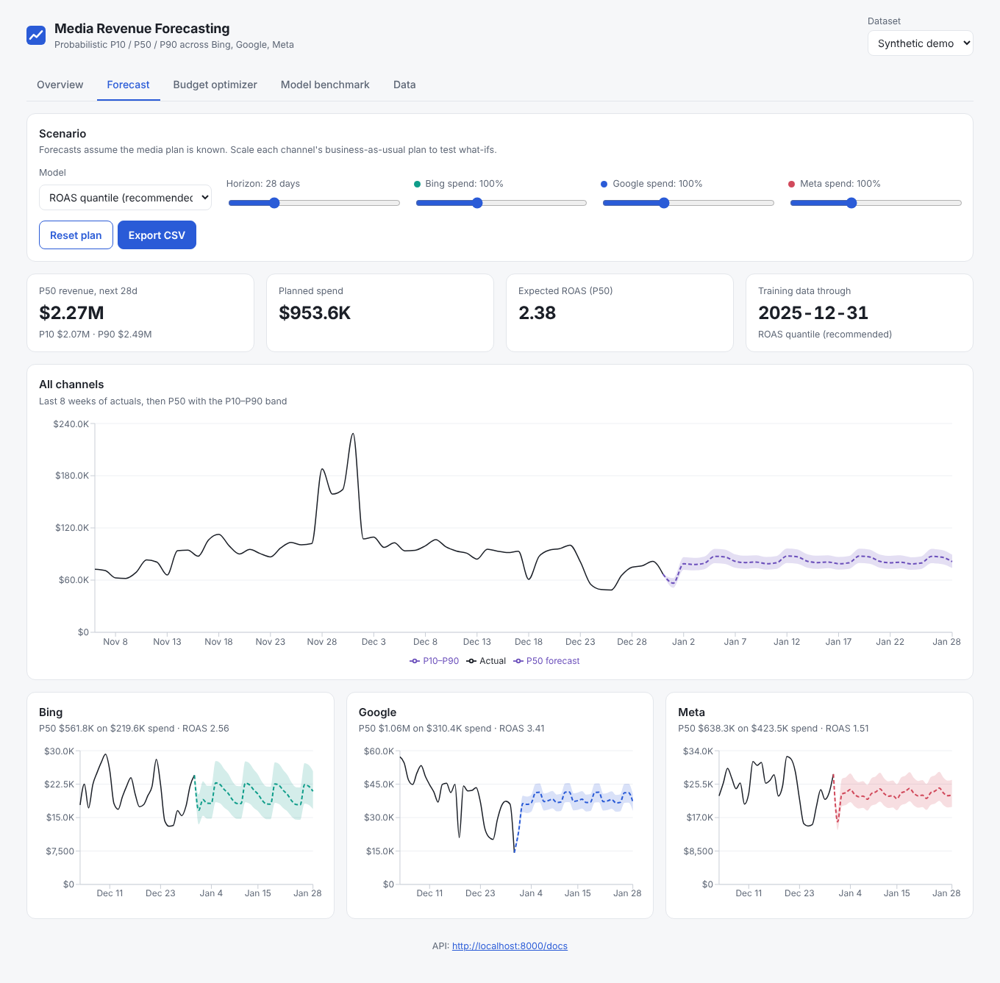
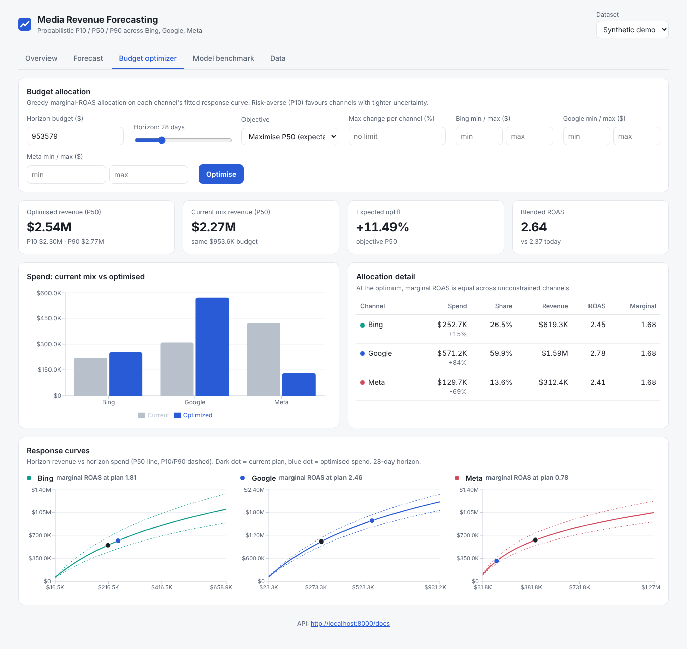
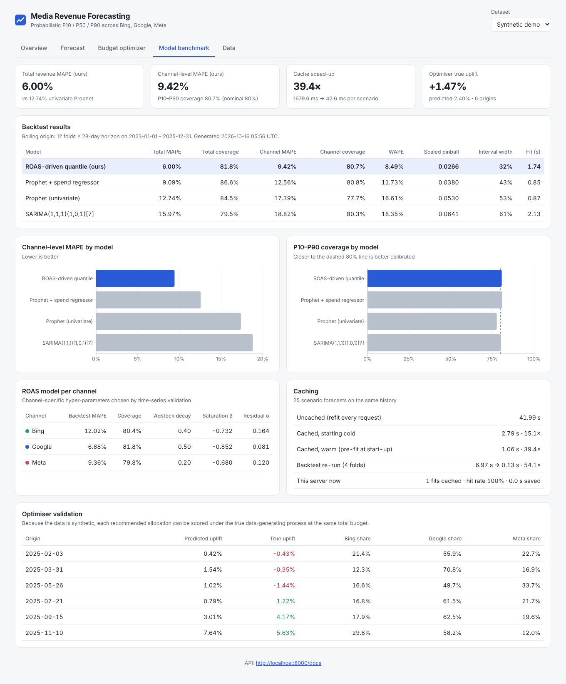

# Media Revenue Forecasting Platform

Probabilistic (P10 / P50 / P90) revenue forecasting and budget allocation for paid media across **Google, Meta and Bing**.

Instead of extrapolating revenue as a univariate time series (Prophet / ARIMA), the platform forecasts **ROAS** per channel and multiplies it by the planned spend. Most revenue variance in paid media comes from budget decisions that are known ahead of time, so ROAS is far more stable and predictable than revenue. Each channel has its own model, and the same fitted response curves drive a budget optimiser.

- **Backend:** FastAPI (Python): models, backtesting, optimiser, caching. Deploys to Render.
- **Frontend:** React + Vite + TypeScript + Recharts dashboard. Deploys to Vercel.



## Results

Rolling-origin backtest on the bundled synthetic dataset (2023-01-01 to 2025-12-31): 12 folds, each a 28-day horizon, with the media plan known in advance. Full output is in [`backend/reports/benchmark.md`](backend/reports/benchmark.md). You can regenerate it with `python -m scripts.benchmark`.

| Model | Total revenue MAPE | P10–P90 coverage (total) | Channel-level MAPE | P10–P90 coverage (channel) | Scaled pinball |
|---|---|---|---|---|---|
| **ROAS-driven quantile (this project)** | **6.00%** | 81.8% | **9.42%** | 80.7% | **0.0266** |
| Prophet + spend regressor | 9.09% | 86.6% | 12.56% | 80.8% | 0.0380 |
| Prophet (univariate) | 12.74% | 84.5% | 17.39% | 77.7% | 0.0530 |
| SARIMA(1,1,1)(1,0,1)[7] | 15.97% | 79.5% | 18.82% | 80.3% | 0.0641 |

Per channel, the ROAS model's MAPE is Google 6.9%, Meta 9.4% and Bing 12.0%. P10–P90 is an 80% interval, so 80% coverage means it is well calibrated. The ROAS model's intervals are also the narrowest: 32% average width, compared with 43–61% for the baselines.

**Caching:** a dashboard session of 25 scenario forecasts took 42.0 s when every request refit the model. With the fit cache it took 2.8 s from cold (**15×** faster) and 1.1 s when the model was pre-fitted at start-up (**39×**). Re-running a backtest with cached fold fits went from 7.0 s to 0.13 s (54×).

**Budget optimiser:** at 6 historical origins, the recommended allocation was scored against the *true* data-generating process at the same total budget. The optimiser predicted an average uplift of +2.4%, and the true average uplift was +1.5%. In 3 of the 6 windows the true uplift was slightly negative (down to −1.4%). This is why the optimiser exposes a trust-region option (`max_change`).

> **About the data.** No real ad-account data ships with this repo. The bundled dataset is synthetic but built to be realistic: adstock carry-over, Hill saturation, budget regime changes, flighted promos, retail peaks, efficiency drift, and noise that is correlated across channels (see [`backend/app/data/generator.py`](backend/app/data/generator.py)). Absolute error levels depend on the noise the generator injects. The meaningful part is the *comparison* between models on identical folds. To run everything on your own data, upload a CSV on the **Data** page or use `POST /api/datasets`.

## How the model works

For each channel *c* and day *t*:

```
log ROAS_ct = β0 + β1·log(adstock_ct / spend_ct)        # carry-over from past spend
                 + β2·log(1 + adstock_ct / κ_c)          # saturation (diminishing returns)
                 + day-of-week + yearly Fourier + retail events + trend
revenue_ct  = spend_ct · ROAS_ct
```

1. **Channel-specific models.** The adstock decay and half-saturation κ are grid-searched per channel on a held-out validation window, with a separate search space and regularisation for each channel (for example, Meta gets longer carry-over and Bing gets stronger shrinkage). Each model is a recency-weighted ridge regression (365-day half-life; 270 days for Meta) with an AR(1) correction on recent residuals.
2. **Quantiles (split-conformal).** An inner rolling backtest over the training window (12 origins × 28 days) collects out-of-sample log residuals. P10, P50 and P90 are the empirical residual quantiles applied to the point forecast.
3. **Channel totals keep correlation.** Residuals are stored jointly by (origin, horizon), so total-revenue intervals sum correlated draws instead of assuming the channels are independent.
4. **Budget optimiser.** The calendar part of each channel's design is precomputed, which gives a fast spend-to-revenue closure for each channel. A greedy marginal-return allocation (1,000 increments) then maximises revenue at the chosen quantile: P50 for expected revenue, P10 for a risk-averse plan, P90 for upside. At the optimum, marginal ROAS is equal across unconstrained channels. Optional per-channel min/max bounds and a ±X% trust region are supported.
5. **Caching.** A two-level cache (in-memory LRU plus on-disk pickle) stores model fits, keyed by dataset fingerprint, model, training cut-off and channel set. It has per-key locks, so concurrent requests never fit the same model twice. On start-up the server pre-fits the default dataset in the background.

Baselines (`backend/app/models/baselines.py`): univariate Prophet with US holidays, Prophet with spend as a regressor (a fairer baseline that also sees the media plan), and SARIMA on log revenue. Each baseline also models the channel total directly.

## Features

| Page | What it does |
|---|---|
| Overview | 28-day KPIs vs the prior 28 days, weekly revenue by channel, weekly ROAS, channel scorecard |
| Forecast | P10–P90 fan charts for the total and each channel, model switcher (ROAS / Prophet / Prophet+spend / SARIMA), horizon 7–90 days, per-channel spend what-if sliders, CSV export |
| Budget optimizer | Total budget, objective (P50 / P10 / P90), per-channel bounds, trust region; current vs optimised allocation, marginal ROAS, uplift with full P10/P50/P90; response curves |
| Model benchmark | Backtest table (MAPE, WAPE, coverage, pinball, interval width, runtime), per-channel hyper-parameters, caching speed-ups, optimiser validation |
| Data | Upload your own daily CSV (`date, channel, spend, revenue`); every page switches to it |

Dark mode follows the system setting, and the layout is responsive down to phone width.

<p float="left">
  
  
</p>

## API

Interactive docs are served at `/docs`.

| Method | Path | Purpose |
|---|---|---|
| GET | `/health` | Health check |
| GET / POST | `/api/datasets` | List datasets / upload a CSV |
| GET | `/api/datasets/{id}` | Dataset summary |
| GET | `/api/history?freq=D\|W\|MS` | Historical spend and revenue per channel |
| GET | `/api/kpis` | Last 28 days vs prior 28 days |
| POST | `/api/forecast` | `{model, horizon, channels?, spend_multipliers?, daily_spend?}` → daily P10/P50/P90 per channel and total, plus horizon totals |
| POST | `/api/optimize` | `{total_budget?, horizon, objective, bounds?, max_change?}` → allocation, marginal ROAS, uplift, P10/P50/P90 |
| GET | `/api/response-curves` | Revenue vs spend curves (P10/P50/P90) per channel |
| GET | `/api/models/roas` | Fitted per-channel hyper-parameters and coefficients |
| GET | `/api/benchmark` | Stored benchmark report |
| POST | `/api/backtest` | Run a rolling backtest on demand |
| GET / DELETE | `/api/cache` | Cache statistics / clear the cache |

Example request:

```bash
curl -X POST localhost:8000/api/forecast -H 'Content-Type: application/json' \
  -d '{"model":"roas_quantile","horizon":28,"spend_multipliers":{"meta":1.2}}'
```

## Run locally

Requires Python 3.11+ (tested on 3.13) and Node 20+.

```bash
# Backend
cd backend
pip install -r requirements-dev.txt
uvicorn app.main:app --reload --port 8000     # http://localhost:8000/docs
pytest -q                                     # 24 tests
python -m scripts.benchmark                   # regenerate reports/benchmark.{json,md} (~4 min)

# Frontend (in another terminal)
cd frontend
npm install
npm run dev                                   # http://localhost:5173
```

The frontend reads the API URL from `VITE_API_URL` and defaults to `http://localhost:8000` (see `frontend/.env.example`).

## Deploy

**Backend on Render**
1. Push this repo to GitHub.
2. In Render, choose **New → Blueprint** and select the repo. It picks up [`render.yaml`](render.yaml), which creates a Python web service with root `backend/`, a build step that runs `pip install -r requirements.txt`, and a start command that runs `uvicorn app.main:app --host 0.0.0.0 --port $PORT`.
3. Once the frontend is live, set `CORS_ORIGINS` to your Vercel URL.

A `backend/Dockerfile` is also included if you prefer a Docker service.

**Frontend on Vercel**
1. Choose **New Project** and import the repo, then set **Root Directory** to `frontend`. Vercel detects Vite automatically, and [`frontend/vercel.json`](frontend/vercel.json) handles SPA rewrites.
2. Add the environment variable `VITE_API_URL=https://<your-render-service>.onrender.com`, then deploy.

Free Render instances sleep when idle, so the first request after a sleep can take around 30 s. The dashboard shows a retry prompt while the backend wakes up.

## Project layout

```
backend/
  app/
    main.py              FastAPI routes
    service.py           datasets, cached fits, forecast/optimise/backtest orchestration
    features.py          adstock, retail calendar, calendar features
    cache.py             LRU + disk model cache
    evaluation.py        MAPE / WAPE / coverage / pinball, rolling-origin backtest
    optimizer.py         response curves + greedy budget allocation
    models/roas_quantile.py   ROAS-driven P10/P50/P90 forecaster
    models/baselines.py       Prophet, Prophet+spend, SARIMA
    data/generator.py    synthetic Google/Meta/Bing dataset + ground truth
  scripts/benchmark.py   reproducible benchmark → reports/
  tests/                 unit + API tests
frontend/
  src/pages/             Overview, Forecast, Optimizer, Benchmark, Data
  src/components/        fan chart, UI primitives
render.yaml              Render blueprint
.github/workflows/ci.yml backend tests + frontend build
```
